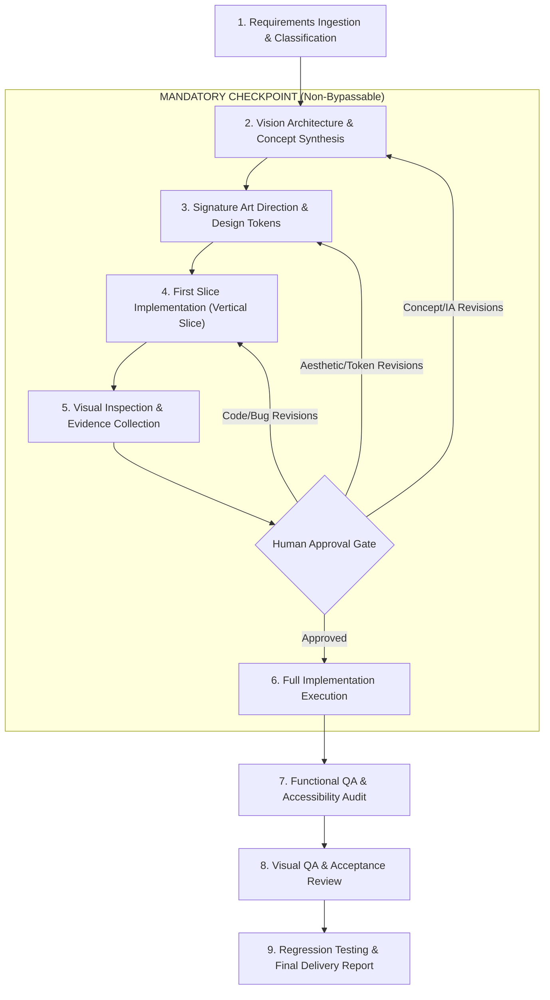

# AURA — Portable Website Engineering Skills

> **A**daptive, **U**ncompromising, **R**esilient **A**rchitecture & Aesthetics for Website Engineering.

AURA is a globally reusable, vendor-agnostic skill and governance system that guides AI coding agents to create distinctive, professional, high-performance websites according to a disciplined design doctrine.

Instead of generating bland, cookie-cutter websites with predictable purple gradients and repetitive 3-card grids, AURA directs AI agents through an architectural pipeline grounded in typography, spatial composition, authentic content, and rigorous quality engineering.

---

## The 10 Core Principles

1. **Distinctive Visual Concept First**: Formulate an authentic, opinionated visual concept and narrative arc *before* writing any frontend markup or styling.
2. **Anti-Cliché & Anti-Boilerplate**: Strictly avoid generic AI website tropes: repetitive 3-card feature grids, blurry gradient spheres, uncurated stock imagery, and buzzword-dense marketing placeholders.
3. **Zero Content Fabrication**: Never fabricate testimonials, metrics, statistics, customer logos, product integrations, screenshots, or simulated benchmark results. Use explicit, transparent placeholders when real assets are unavailable.
4. **Zero Layout Breakage**: Overlapping text, clipped containers, horizontal body overflows, unhandled notch safe-areas, or unreadable contrast states are critical build-failing defects.
5. **Deliberate Mobile & Desktop Craft**: Mobile and desktop viewports are designed with intentional ergonomic adaptations, not treated as afterthought responsive shrinks.
6. **Purposeful Media & Motion**: Animations, 3D elements, SVG illustrations, and kinetic micro-interactions must serve clear narrative or functional purposes, with strict adherence to `prefers-reduced-motion`.
7. **Equally Weighted Quality Pillars**: Functionality, accessibility (WCAG 2.2 AA minimum), runtime performance, code maintainability, and aesthetic excellence share equal priority.
8. **Doctrine Defaults, Client Authority**: The built-in Personal Design Doctrine provides opinionated defaults when projects lack guidance. Stated client branding, project requirements, and design tokens always take precedence.
9. **Strict Decision Taxonomy**: Every architectural and aesthetic decision must be categorized and logged:
   - `[EXPLICIT_REQUIREMENT]`: Mandated by client or prompt.
   - `[OBSERVED_PREFERENCE]`: Derived from brand assets or reference materials.
   - `[INFERENCE]`: Logical derivation required to fulfill functional intent.
   - `[PROPOSAL]`: Agent-suggested innovation awaiting human approval.
10. **Radical Verification Truth**: Never claim a browser test, screenshot inspection, build, or accessibility audit occurred unless it was actually executed and verified with tangible output. Transparent fallback protocols apply when visual tools are unavailable.

---

## The Non-Bypassable Workflow Pipeline

AURA enforces a strict, gated 9-stage engineering pipeline with a mandatory human approval checkpoint:



> [!CRITICAL]
> **The Human Approval Checkpoint Rule**: Under no circumstances may an AI agent approve its own design, bypass Stage 5, or proceed to full-site expansion without explicit, human-provided approval of the representative first slice. Silence or elapsed time is NEVER treated as approval.

---

## Repository Structure

```text
AURA/
├── README.md                          # Global system overview, principles, and lifecycle
├── AGENTS.md                          # Universal agent contract, roles, and communication protocol
├── skills/                            # Portable specialist skills
│   ├── website-orchestrator/          # Master coordinator of the 9-stage pipeline
│   │   └── SKILL.md
│   ├── website-vision-architect/      # Concept, layout archetype, and narrative IA
│   │   └── SKILL.md
│   ├── signature-art-direction/       # Typography, color science, tokens, and visual rhythm
│   │   └── SKILL.md
│   ├── frontend-experience-engineer/  # Component implementation, responsive CSS, and state
│   │   └── SKILL.md
│   ├── web-quality-engineer/          # Automated functional, a11y, perf, and stress QA
│   │   └── SKILL.md
│   └── visual-acceptance-reviewer/    # Visual QA, screenshot audits, and rendering fidelity
│       └── SKILL.md
├── scripts/                           # Reproducible regression & verification test runners
│   ├── test-regression.mjs            # Built-in Node test runner (zero external dependencies)
│   └── audit-content-authenticity.mjs # Content authenticity & pseudo-metadata scanner
├── references/                        # Shared doctrines, standards, and historical records
│   ├── PERSONAL-DESIGN-DOCTRINE.md    # Baseline aesthetic philosophy and layout archetypes
│   ├── WEBSITE-QUALITY-STANDARD.md    # Multi-dimensional engineering benchmarks
│   ├── DESIGN-DECISION-LOG.md         # Immutable decision ledger with 4-category taxonomy
│   └── MEASURED-LIGHT-FIRST-SLICE-BRIEF.md # Case study first-slice build brief
├── evaluations/                       # Repeatable evaluation suites and rubrics
│   ├── design-evals.md                # Anti-cliché, brand alignment, and aesthetic rubrics
│   └── quality-evals.md               # Stress testing, a11y benchmarks, and regression suites
└── adapters/                          # Agent runtime environment integration guides
    ├── README.md                      # Cross-agent adaptation philosophy
    └── agent-specific-notes.md        # Antigravity, Claude Code, Cursor, Copilot, Windsurf guides
```

---

## Verification & Regression Testing

AURA includes a built-in, zero-dependency regression test runner under `scripts/`:

### 1. Browser-Free Regression Suite (Fresh Clone)
Run immediately from any fresh checkout with standard Node.js (no `npm install` needed):
```bash
node scripts/test-regression.mjs
```
Verifies decision-log schema integrity, content authenticity (prohibiting unbracketed fake camera/GPS metadata), dignified placeholder markup, portable relative references, and mobile CSS ergonomics.

### 2. Standalone Content Authenticity Scanner
```bash
node scripts/audit-content-authenticity.mjs [path/to/file.html]
```

### 3. Full Suite with Live Browser Checks (CDP)
When Google Chrome and a local preview server (`http://localhost:3000`) are available:
```bash
# Optional: export CHROME_PATH="/path/to/chrome"
node scripts/test-regression.mjs --with-browser
```
Tests multi-viewport horizontal overflow (320px–1440px), mobile action bar collision clearance at scroll bottom, and drawer concealment.

---

## Role Matrix & Responsibilities

| Specialist Skill | Primary Responsibility | Key Deliverables |
| :--- | :--- | :--- |
| **`website-orchestrator`** | Lifecycle coordination, gate enforcement, decision logging | `DESIGN-DECISION-LOG.md`, Milestone reviews, Final Delivery Report |
| **`website-vision-architect`** | Concept synthesis, thematic archetype, narrative IA | Concept Document, Sitemap & IA Blueprint |
| **`signature-art-direction`** | Typography hierarchy, color science, design tokens | `tokens.css` / theme schema, Style Tile |
| **`frontend-experience-engineer`** | First slice build, full-site construction, animations | Semantic components, responsive stylesheets |
| **`web-quality-engineer`** | Test execution, performance budgets, WCAG 2.2 audit | Automated test logs, Lighthouse/a11y reports |
| **`visual-acceptance-reviewer`** | Multi-viewport screenshot inspection, optical balance | Visual inspection reports, defect logs |

---

## Portability & Multi-Agent Compatibility

AURA is architected for cross-agent portability without proprietary tool dependencies:
- **Google Antigravity & Gemini CLI**: Primary reference environment with native skill ingestion, command execution, and multimodal tool support.
- **Anthropic Claude Code**: Reference configuration provided via terminal execution and subagent commands (*runtime empirical validation pending*).
- **Cursor & Windsurf**: Reference configuration provided via workspace rules and multi-turn persona adoption (*runtime empirical validation pending*).
- **OpenAI Codex / ChatGPT / Copilot**: Compatible via markdown prompt ingestion (*runtime empirical validation pending*).

For tool mappings, headless fallback behaviors, and agent-specific configurations, see [`adapters/agent-specific-notes.md`](adapters/agent-specific-notes.md).
